<p align="center">
  
</p>

<h1 align="center">Nomi</h1>

<p align="center">
  <b>Understand every lecture, in your own language.</b><br>
  Live transcription and translation on your Mac or PC, with an assistant that knows your classes.
</p>

<p align="center">
  <strong>English</strong> · <a href="README.zh-CN.md">中文</a> · <a href="https://nomi.software">nomi.software</a>
</p>

<p align="center">
  <picture>
    <source media="(prefers-color-scheme: dark)" srcset="Design/README/hero-dark.svg">
    
  </picture>
</p>

<p align="center">
  <a href="https://github.com/Jasonsu22/Nomi/releases/latest/download/Nomi-arm64.dmg"></a>
  <a href="https://github.com/Jasonsu22/Nomi/releases/download/windows-v0.10.1/Nomi-0.10.1-x64-setup.exe"></a>
  <a href="https://nomi.software/#video"></a>
</p>

<p align="center">
  <a href="https://github.com/Jasonsu22/Nomi/releases/latest"></a>
  <a href="https://github.com/Jasonsu22/Nomi/releases"></a>
  
  
  
  
</p>

## 💡 Why Nomi

Studying in a second language is hard. The teacher talks fast, new terms are everywhere, and you can't listen and take notes at the same time. Nomi does the listening and writing for you, translates every passage right under the original, and answers your questions about the class afterwards. Speech recognition and translation run on your Mac, so your classes stay with you.

## ✨ What it does

<table>
  <tr>
    <td width="50%" valign="top">
      <h3>🎙️ Live transcription</h3>
      Words appear as the teacher speaks, then settle into sentences with the translation underneath. Pause and resume anytime. Works with AirPods and other Bluetooth mics.
    </td>
    <td width="50%" valign="top">
      <h3>❓ The teacher's questions, answered</h3>
      The Q&amp;A tab collects the real questions asked in class (not "right?" or "can you hear me?") and answers each one. Every question jumps to its moment in the transcript.
    </td>
  </tr>
  <tr>
    <td valign="top">
      <h3>💬 Ask about anything you recorded</h3>
      "What did the teacher say about the exam last week?" Nomi searches all your lectures, earlier chats and files, and shows where every part of the answer came from. Turn on Web to add the internet.
    </td>
    <td valign="top">
      <h3>🧪 Interactive demos</h3>
      When an idea is easier to see than to read, the answer comes with a small interactive page: drag a slider, press a button, watch the concept move.
    </td>
  </tr>
  <tr>
    <td valign="top">
      <h3>📎 Slides and readings</h3>
      Import PDFs, slides and documents, link them to a lecture, and Nomi reads them together with the transcript.
    </td>
    <td valign="top">
      <h3>📝 Summaries</h3>
      Turn a 90-minute lecture into key points, new terms and conclusions, kept with the meeting for revision.
    </td>
  </tr>
  <tr>
    <td valign="top">
      <h3>🧩 Learns how you study</h3>
      Nomi remembers your preferences, courses and exam dates and uses them in later answers. See, edit or turn it off in Settings › Memory.
    </td>
    <td valign="top">
      <h3>🔒 Private by design</h3>
      Recognition and translation run on your Mac and work offline. Questions use a local model or your own API, and keys stay on your Mac.
    </td>
  </tr>
</table>

You can also chat while a lecture is recording. Live transcription always keeps priority. Nomi supports Chinese, English, Japanese, Korean, German, French, Spanish, Russian and Arabic.

## 🚀 Install

### Mac

1. **[Download Nomi](https://github.com/Jasonsu22/Nomi/releases/latest/download/Nomi-arm64.dmg)**, open the DMG and drag Nomi into Applications.
2. Open Nomi. Because it is not yet notarized by Apple, macOS says it can't verify it; click **Done**.
3. Open **System Settings › Privacy & Security** (the DMG has an *Open Settings* shortcut), click **Open Anyway** next to Nomi, and confirm with your password.

You only do this once. Nomi needs macOS 26 or later on Apple silicon (M1 or newer).

### Windows (preview)

1. **[Download the Windows installer](https://github.com/Jasonsu22/Nomi/releases/download/windows-v0.10.1/Nomi-0.10.1-x64-setup.exe)** and run it. It installs for your account, so no administrator rights are needed.
2. If Windows says "Windows protected your PC", choose **More info › Run anyway**. The installer is not signed yet.
3. Open Nomi from the Start menu. The setup guide downloads the models that suit your PC (1–4 GB).

Nomi for Windows runs on Windows 10 and 11, 64-bit. It uses an NVIDIA, AMD or Intel graphics card through Vulkan when there is one, and the processor otherwise.

<details>
<summary><b>FAQ</b></summary>

**Do I need the internet in class?** No. After the models are downloaded once, transcription and translation work offline. You only need the internet for Web search or an API model.

**Is it okay to record my lectures?** Rules differ between schools and countries. Check your university's policy and ask your teacher first.

**How much does it cost?** Nomi is free and open source under the MIT license. If you connect your own API for questions, that provider may charge you.

**Where do I report a problem?** Open an [issue](https://github.com/Jasonsu22/Nomi/issues), or use *Help › Contact us* in the app.

</details>

## 🛠️ For developers

Nomi has two apps that share one Rust engine (`Backend/moxin-engine`):

- **Mac:** a SwiftUI interface (Swift module `LectureNoteApp`) with MLX workers.
- **Windows:** a Tauri 2 + React interface (`Windows/app`) with GGUF workers on [llama.cpp](https://github.com/ggml-org/llama.cpp) and transcribe.cpp. The workers use Vulkan when there is a graphics card and the CPU otherwise.

<details>
<summary><b>Build on a Mac</b></summary>

You need an Apple Silicon Mac, macOS 26, Xcode (Swift 6.2), and Rust. The first build downloads dependencies, including a pinned revision of [OminiX-MLX](https://github.com/OminiX-ai/OminiX-MLX).

```sh
bash scripts/build-app.sh
open build/Nomi.app
```

`build-app.sh` accepts `debug` (the default) or `release` and writes `build/Nomi.app`. The `build/` directory is not committed.

After a Swift-only change, refresh the existing app without rebuilding Rust:

```sh
bash scripts/refresh-app.sh
```

That script requires `build/Nomi.app` to exist already.

To package a release, build it, then make the DMG:

```sh
bash scripts/build-app.sh release
bash scripts/build-dmg.sh
bash scripts/make-appcast.sh release-notes.md
```

`build-dmg.sh` writes `build/Nomi-<version>-arm64.dmg` with the installer background and the first-launch guide from `Design/DMG/`. It installs [dmgbuild](https://github.com/dmgbuild/dmgbuild) into `build/.dmgbuild-venv` on first use, and refuses debug and dev-key builds. `make-appcast.sh` signs it for automatic updates and writes `build/updates/`. Attach `build/updates/Nomi-arm64.dmg` and `build/updates/appcast.xml` to a GitHub release tagged `v<version>` and mark it Latest: the website's download link and the in-app updater (Sparkle, checking once a day) both read the latest release. Updates are signed with an EdDSA key kept in the login Keychain, so releases must be made on the Mac that holds it.

</details>

<details>
<summary><b>Build on Windows</b></summary>

You need Windows 10 or 11 (x64) and:

- Visual Studio 2022 with **Desktop development with C++**, including its CMake, Ninja and **C++ Clang tools** (LLVM)
- [Rust](https://rustup.rs) (the MSVC toolchain)
- [Node.js](https://nodejs.org) 22
- The [Vulkan SDK](https://vulkan.lunarg.com/sdk/home#windows)

Work in an **x64 Native Tools Command Prompt for VS 2022**, from the repository folder:

```bat
set LIBCLANG_PATH=%VCINSTALLDIR%Tools\Llvm\x64\bin
set CMAKE_GENERATOR=Ninja
set NOMI_TARGETS=C:\t
powershell -ExecutionPolicy Bypass -File Windows\scripts\build-engine.ps1
cd Windows\app
npm ci
npx tauri build --bundles nsis
```

- **Engine and workers:** `build-engine.ps1` builds `moxin-engine` and the two workers into `Windows/app/src-tauri/engine`, which the installer bundles. You only need to run it again when the engine or workers change.
- **The installer:** `npx tauri build` writes `Windows/app/src-tauri/target/release/bundle/nsis/Nomi_<version>_x64-setup.exe`, which installs for the current account.
- **While you work on the interface:** run `npx tauri dev` instead.
- **`NOMI_TARGETS`:** keeps the build folders at a short path, because llama.cpp's Vulkan shader build goes past MSVC's 260-character path limit.
- **Linker errors** such as `__std_max_element_f`: if your Visual Studio is newer than its standard library, open the prompt with `vcvars64.bat -vcvars_ver=14.44`.

To release, bump the version in `Windows/app/package.json`, `src-tauri/Cargo.toml` and `src-tauri/tauri.conf.json`. Then attach the installer, renamed `Nomi-<version>-x64-setup.exe`, to a GitHub release tagged `windows-v<version>`. Publish it as a pre-release and not Latest, because Latest is what the Mac updater reads. The Windows app looks for a newer installer among the `windows-v*` releases.

You can also work on the Windows interface on a Mac. `bash Windows/scripts/build-engine.sh` builds the engine and workers for macOS. `cd Windows/app && npx tauri dev` then runs the app, with its data in `~/Library/Application Support/Nomi-Windows-dev`, apart from the Mac app's data.

</details>

<details>
<summary><b>Modules</b></summary>

| | Module | Where |
| --- | --- | --- |
| 🖥️ | SwiftUI interface, meetings, Ask, and settings | `Sources/LectureNoteApp/` |
| 🧪 | Swift tests | `Tests/LectureNoteTests/` |
| ⚙️ | Local engine, `moxin-engine` | `Backend/moxin-engine/` |
| 🗣️ | Speech-recognition worker | `Backend/workers/asr-worker/` |
| 🌐 | Translation and local question worker | `Backend/workers/llm-worker/` |
| 📦 | ASR loader shipped with this repo | `Backend/vendor/qwen3-asr-mlx/` |
| 🪟 | Windows interface (Tauri + React) | `Windows/app/src/` |
| 🦀 | Windows platform layer: files, audio, OCR, secrets | `Windows/app/src-tauri/` |
| 🧠 | Windows GGUF workers | `Windows/engine/` |
| 🎨 | Logo, app icon, DMG and README art | `Design/` |
| 🌍 | Website | `website/` |

The packager copies `moxin-engine`, `asr-worker`, `llm-worker`, and `mlx.metallib` from `Backend/target`. Packaging stops if any of them is missing.

You do not need a checkout of [Moxin-Voice](https://github.com/moxin-org/Moxin-Voice) or [Moxin-Studio](https://github.com/moxin-org/Moxin-Studio) to compile or run Nomi. The engine, both workers, and the patched Qwen3-ASR loader are already in `Backend/`. The app starts that engine itself and stops it on quit. Debug builds look for `Backend/target/debug/moxin-engine`. The packaged app uses only the copy inside the bundle.

Downloaded weights stay in `~/.OminiX/models`. On a Mac without them, download the models again from Settings.

</details>

<details>
<summary><b>Where data is stored</b></summary>

On a Mac:

| What | Where |
| --- | --- |
| Meetings, categories and meeting summaries | `~/Library/Application Support/Nomi/meetings.json` |
| Source index and file copies | `~/Library/Application Support/Nomi/sources.json` and `sources/` |
| Links between meetings and sources | `~/Library/Application Support/Nomi/meeting-links.json` |
| Ask history | `~/Library/Application Support/Nomi/chats/` |
| Meeting Q&A | `~/Library/Application Support/Nomi/qa/` |
| Memory | `~/Library/Application Support/Nomi/memory.json` |
| Local models | `~/.OminiX/models` |
| API keys | `~/Library/Application Support/Nomi/api-keys.json` (readable only by your account) |
| Engine log | `~/Library/Logs/Nomi/engine.log` |

Interface language, appearance, microphone permission, the selected local model, and API profiles are stored in the app’s UserDefaults.

On Windows, everything is in `%LOCALAPPDATA%\software.nomi.windows`, apart from the program in `%LOCALAPPDATA%\Nomi`. Updating or uninstalling Nomi does not touch your data.

| What | Where |
| --- | --- |
| Meetings, sources, Ask history and Q&A | `meetings.json`, `sources.json`, `sources/`, `chats/`, `qa/` (the same files as on the Mac) |
| Settings | `prefs.json` |
| Local models | `models\` |
| API and web-search keys | Windows Credential Manager |
| Logs | `engine.log` and `ui.log` |

</details>

<details>
<summary><b>Tests</b></summary>

On a Mac:

```sh
swift test
cargo test --manifest-path Backend/Cargo.toml --locked
```

On Windows:

```bat
cargo test --release --manifest-path Backend\Cargo.toml -p moxin-engine -p voice-core
cargo test --release --manifest-path Windows\engine\Cargo.toml -p asr-worker
cd Windows\app\src-tauri && cargo test --release --lib
cd .. && npm run typecheck
```

Pushes to `main` and pull requests run GitHub Actions. Swift is built and tested on macOS 26. The engine crates that do not use MLX (`voice-core` and `moxin-engine`) are tested on Linux. The speech and translation workers need Apple’s MLX, so that Linux runner does not compile them. When the Windows app or the shared engine changes, a Windows runner builds the engine, both workers and the installer, then runs the tests above.

</details>

## 🙏 Acknowledgements

The live transcription path began in Moxin-Voice. Thank you. Nomi’s own interface and the work written for this app are MIT. Code and ideas taken from other projects stay under those projects’ licenses.

| Project | What Nomi took from it | Their license |
| --- | --- | --- |
| [Moxin-Voice](https://github.com/moxin-org/Moxin-Voice) | The live transcription engine, the speech and translation workers, and the shared voice pipeline. Nomi continues that work in `Backend/`. | Apache-2.0 |
| [Moxin-Studio](https://github.com/moxin-org/Moxin-Studio) | The shape of the local model manager, and the set of text API providers. | Apache-2.0 |
| [OminiX-MLX](https://github.com/OminiX-ai/OminiX-MLX) | The Apple Silicon inference crates, pinned at `6aac996`. The patched ASR loader in `Backend/vendor/qwen3-asr-mlx/` comes from this tree. | Apache-2.0. The vendored loader is also shipped with its MIT text. |
| [Qwen3-ASR](https://github.com/QwenLM/Qwen3-ASR) | The prompt format and the way recognition output is parsed. | Apache-2.0 |
| [MLX](https://github.com/ml-explore/mlx) | The array framework underneath OminiX-MLX. | MIT |

## 📄 License

Nomi’s own source is [MIT](LICENSE). Copyright 2026 Jason Su.

Imported and vendored code keeps its original license:

- `Backend/`, adapted from Moxin-Voice, remains [Apache-2.0](Backend/LICENSE).
- `Backend/vendor/qwen3-asr-mlx/` remains under the [MIT](Backend/vendor/qwen3-asr-mlx/LICENSE-MIT) and [Apache-2.0](Backend/vendor/qwen3-asr-mlx/LICENSE-APACHE) texts shipped with it.
